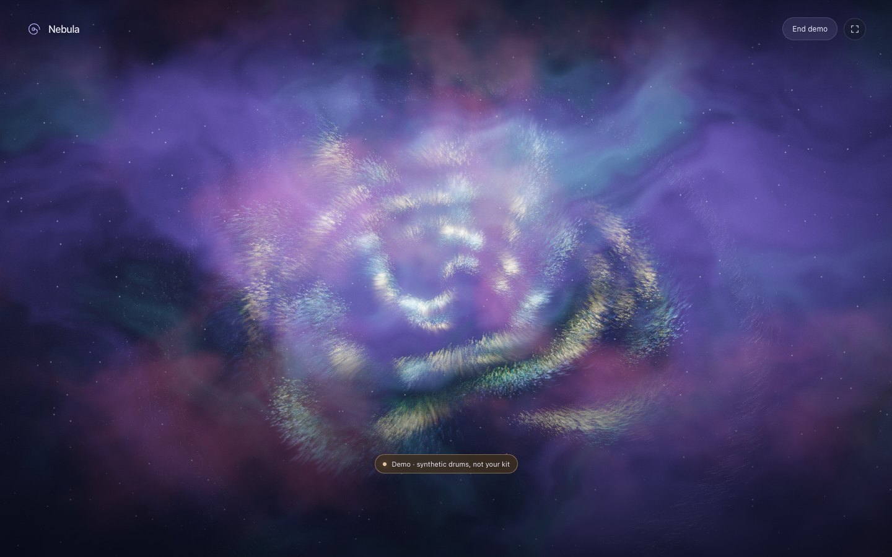
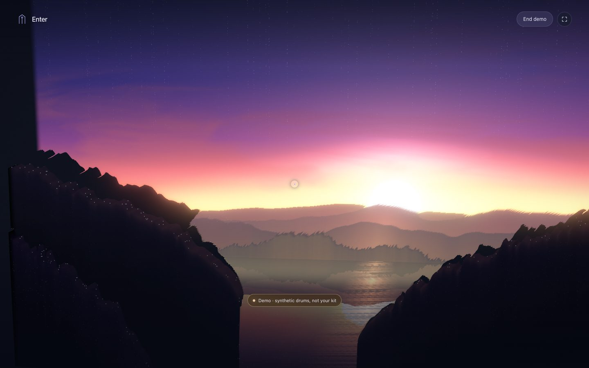
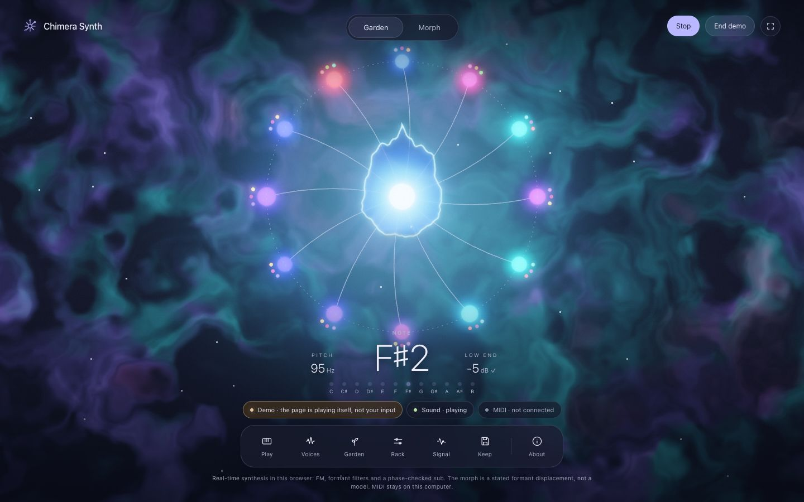
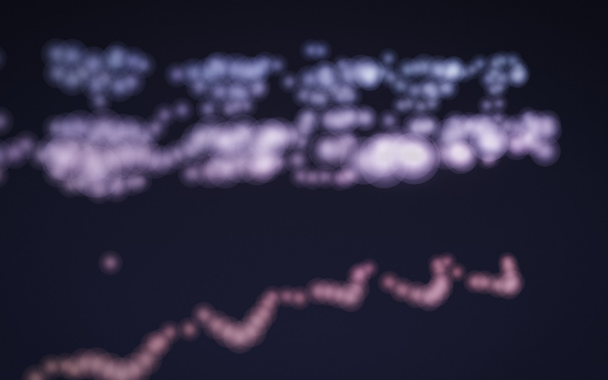
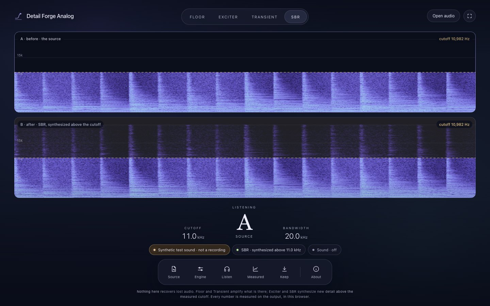

# Generative AV Labs

**[Open the home page](https://patrickiben.github.io/generative-av-labs/)** · [Nebula](https://patrickiben.github.io/generative-av-labs/nebula.html) · [Biofeedback Nebula](https://patrickiben.github.io/generative-av-labs/biofeedback-nebula.html) · [Enter](https://patrickiben.github.io/generative-av-labs/enter.html) · [Chimera Synth](https://patrickiben.github.io/generative-av-labs/chimera.html) · [Detail Forge Analog](https://patrickiben.github.io/generative-av-labs/analog.html) · [Displacer](https://patrickiben.github.io/generative-av-labs/displacer.html) · [Field guide](https://patrickiben.github.io/generative-av-labs/field-guide.html)

Browser instruments for light and sound. Each page runs in your browser. There is no helper app and no server, and your audio, MIDI and pictures never leave the browser. Nebula, Chimera Synth, Detail Forge Analog and Displacer use no model. Enter uses one, a depth estimate for your own picture, which downloads only when you ask.



**Nebula** hangs the last twelve seconds of your playing in the air. Every hit is born at the core and winds outward along a spiral, with color set by frequency and brightness by loudness. Hits stir a small fluid field. Form mode lifts a picture and a sound into clouds, matches them by sliced optimal transport, and lets you move the mass between them.

**Biofeedback Nebula** joins Nebula's particle and fluid engine with the heart-rate controls from Body Signal Labs. Watch uses Autonomic Telemetry's engine to score your shift from a two-minute personal reference, and a higher score warms and widens the gas. Field lets drums, heart rate, or brainwaves drive the particles. Train follows a breathing ring at 4.5 to 7 breaths a minute and gathers the dust into a ring as your heart rate swings with it. Form morphs a picture into a sound, as in Nebula. A heart-rate sensor connects over Web Bluetooth in Chrome or Edge. Brainwaves and the other Muse S modes run here only as a labeled synthetic preview: Muse needs the Mac launcher in Body Signal Labs, and that launcher does not serve this page. No test or validation note covers this page yet. The score, the brainwave control, and the breathing clarity are personal heuristics and game proxies, not medical measurements.

**Enter** lets you walk into a picture and fly through a sound. The sound world is a synesthetic map: time runs along X, pitch climbs and salience comes toward you, and the same sound lies below as terrain. Enter takes a picture or a sound, and it has no drum input. The picture world is a depth relief you walk through. Your own picture gets its depth from Depth Anything V2 Small (Apache-2.0) on ONNX Runtime Web. The first time, the page asks and then downloads about 76 MB from Hugging Face and jsDelivr. Without WebGPU, it downloads about 41 MB and runs on the processor. The print world casts a sound into a watertight STL. Grow World and Make 3D Object stay in the desktop app, because no browser path was found for SDXL or TripoSR.





**Chimera Synth** is a bass you breed by ear. A genome of 20 genes grows the voice: drag a bud toward its tip and hear the seed lean that way, then let go to grow a new seed. Morph mode blends fifteen animal voices, from a mallard to a dolphin, by sliding their formants along a log-frequency axis. A phase check measures the low end and locks the sub where it adds up. A MIDI keyboard plays it over Web MIDI, and so do the computer keys. It came from the desktop Bio-Bass Chimera Lab, whose page is kept in `legacy/` with one hardware comment removed.



**Displacer** blends two sounds without a crossfade. It moves each moment's energy along frequency by an optimal-transport map, so a resonance slides from one sound into the other instead of fading out while the other fades in. The opening view shows the blend’s spectrogram with time and frequency axes. While listening, moving the slider updates the sound at the same playback position as each new render completes. The Space view splits both sounds into Gabor atoms, a 3D cloud you can turn while the slider carries one sound's atoms into the other's. Genopatch grows a playable FM voice that fits a sound, and every blend saves as a WAV, a spectrogram poster or a point cloud. The mod wheel moves the blend. It came from the desktop Displacer, which also blends pictures; that page is kept unchanged in `legacy/`, and two defects in its sound engine, blends about 250 times too quiet and a granular effect that did not repeat, are fixed here.



**Detail Forge Analog** now follows the image app’s source-plus-detail workflow. Forge analyzes short stretches for tonal peaks, diffuse texture and attacks, synthesizes a separate high-frequency layer, and adds it to the source through a band guard. Choose the amount, guard cutoff, upper limit and texture seed; hear the original, a loudness-matched result, or just the added layer at its actual level. The source stays underneath; headroom control turns down only the new layer. Its invented texture is procedural, not recovered audio or neural super-resolution. The estimated cutoff can be overridden, and measured guard leakage and residual energy make the result inspectable. The four older effects remain available as comparison controls. Everything runs locally in a browser worker, with 24-bit WAV and settings/metrics exports. See [the Forge method and checks](docs/FORGE.md).

## Wire a drum kit for Nebula

- **Audio:** the module's main outputs to two line inputs on your audio interface.
- **MIDI:** many audio interfaces have no MIDI ports, and a module's USB port is not always MIDI. If so, run a 5-pin cable from the module's MIDI OUT into a USB-MIDI interface.
- **Browser:** Chrome or Edge. Safari has no Web MIDI, and Firefox asks for a site permission add-on.

[Inputs](docs/INPUTS.md) has the browser support, with sources.

## What it tells you

Nebula says at all times which of these it is in, for audio and MIDI separately: not connected, waiting for permission, **permission denied**, **no device**, **device open with no signal**, live, or disconnected. A demo and a replay carry their own labels, so synthetic drums can never read as your kit.

## Open it locally

The instrument pages are self-contained. Open `nebula.html` or `chimera.html` directly, or serve the folder:

```sh
python3 -m http.server 8090
```

Edit `src/`, then run `python3 build.py`, which inlines everything into the pages.

## Read more

- [Field guide](field-guide.html): wiring, statuses, what each drum does in Nebula, connecting Chimera Synth, and Detail Forge Analog.
- [Inputs](docs/INPUTS.md): wiring a kit and browser support, with sources.
- [Methods](docs/METHODS.md): onset detection, tempo, the fluid field, the feedback loop and transport.
- [Review](docs/REVIEW.md): follow-up bug fixes and recommended next improvements.
- [Validation](docs/VALIDATION.md): what was tested, how, and what still needs real gear.

## Elsewhere

Endless Cockpit moved on 2026-11-03 to [Body Signal Labs](https://github.com/patrickiben/body-signal-labs), with Autonomic Telemetry and Biofeedback Path Cockpit. Its old address here forwards there.

## Credit

No outside code is included. Ideas came from [Butterchurn](https://github.com/jberg/butterchurn) (MIT), [WebGL Fluid Simulation](https://github.com/PavelDoGreat/WebGL-Fluid-Simulation) (MIT), [paper-cranes](https://github.com/loqwai/paper-cranes) (BSD-3-Clause), [@audio/beat](https://github.com/audiojs/beat) and [realtime-bpm-analyzer](https://github.com/dlepaux/realtime-bpm-analyzer) (Apache-2.0).

MIT license.
