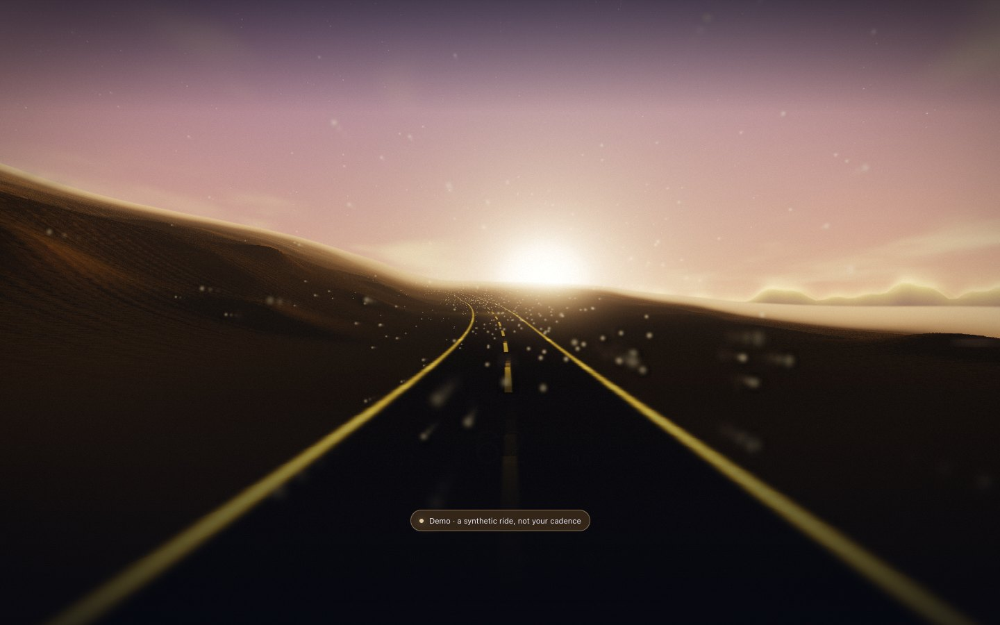

# Generative AV Labs

**[Open the home page](https://patrickiben.github.io/generative-av-labs/)** · [Nebula](https://patrickiben.github.io/generative-av-labs/nebula.html) · [Endless Cockpit](https://patrickiben.github.io/generative-av-labs/endless-cockpit.html) · [Enter](https://patrickiben.github.io/generative-av-labs/enter.html) · [Chimera Synth](https://patrickiben.github.io/generative-av-labs/chimera.html) · [Displacer](https://patrickiben.github.io/generative-av-labs/displacer.html) · [Field guide](https://patrickiben.github.io/generative-av-labs/field-guide.html)

Generative light and sound in the browser. Each page takes something different: a picture, a sound, a keyboard, a drum kit or a bike sensor. There is no helper app and no server, and your audio, MIDI and pictures never leave the browser. Nebula, Endless Cockpit, Chimera Synth and Displacer use no model. Enter uses one, a depth estimate for your own picture, which downloads only when you ask.


**Nebula** hangs the last twelve seconds of your playing in the air. Every hit is born at the core and winds outward along a spiral, with color set by frequency and brightness by loudness. Hits stir a small fluid field. Form mode lifts a picture and a sound into clouds, matches them by sliced optimal transport, and lets you move the mass between them.



**Endless Cockpit** is a road at dusk that keeps time. Your tempo sets the speed, the kick surges you forward and sends a ring of light down the road, and the horizon is your live spectrum. The scene is raymarched each frame and fed through a zoom-feedback loop. Ride mode takes speed from a Bluetooth cadence sensor instead, directly from the browser.

**Enter** lets you walk into a picture and fly through a sound. The sound world is a synesthetic map: time runs along X, pitch climbs and salience comes toward you, and the same sound lies below as terrain. Enter takes a picture or a sound, and it has no drum input. The picture world is a depth relief you walk through. Your own picture gets its depth from Depth Anything V2 Small (Apache-2.0) on ONNX Runtime Web. The first time, the page asks and then downloads about 76 MB from Hugging Face and jsDelivr. Without WebGPU, it downloads about 41 MB and runs on the processor. The print world casts a sound into a watertight STL. Grow World and Make 3D Object stay in the desktop app, because no browser path was found for SDXL or TripoSR.


**Chimera Synth** is a bass you breed by ear. A genome of 20 genes grows the voice: drag a bud toward its tip and hear the seed lean that way, then let go to grow a new seed. Morph mode blends fifteen animal voices, from a mallard to a dolphin, by sliding their formants along a log-frequency axis. A phase check measures the low end and locks the sub where it adds up. Your kit plays it over Web MIDI, each drum a stated pitch. It came from the desktop Bio-Bass Chimera Lab, whose page is kept unchanged in `legacy/`.


**Displacer** blends two pictures or two sounds without a crossfade. It moves the mass along an optimal-transport map: colors slide toward the other picture's palette, pixels travel to new places, and a sound's energy moves along frequency. The Space view lifts the pair into a 3D cloud of splats that you can turn while the slider carries one into the other. Genopatch grows a playable FM voice that fits a sound, and every blend saves as a PNG, a WAV or a point cloud. The mod wheel moves the blend. It came from the desktop Displacer, whose page is kept unchanged in `legacy/`; two defects there, sound blends about 250 times too quiet and a granular effect that did not repeat, are fixed here.

## Wire it

For a Pearl Mimic Pro and a Universal Audio Apollo Solo:

- **Audio:** Mimic Pro Line Out 1 and 2 (the main mix) to Apollo Solo rear Mic/Line 1 and 2, set to Line. Leave the front Hi-Z jack empty.
- **MIDI:** the Apollo Solo has no MIDI ports, and the Mimic Pro's USB slot is for installing samples. Run a 5-pin cable from the module's MIDI OUT into a USB-MIDI interface.
- **Browser:** Chrome or Edge. Safari has no Web MIDI, and Firefox asks for a site permission add-on.

Any audio interface and any kit with MIDI works the same way. [DEVICES](docs/DEVICES.md) has the sources for all of this.

## What it tells you

Each page says at all times which of these it is in, for audio and MIDI separately: not connected, waiting for permission, **permission denied**, **no device**, **device open with no signal**, live, or disconnected. A demo and a replay carry their own labels, so synthetic drums can never read as your kit.

## Open it locally

The two instrument pages are self-contained. Open `nebula.html` or `endless-cockpit.html` directly, or serve the folder:

```sh
python3 -m http.server 8090
```

Edit `src/`, then run `python3 build.py`, which inlines everything into the pages.

## Read more

- [Field guide](field-guide.html): wiring, statuses and what each drum does.
- [Devices](docs/DEVICES.md): the hardware route and browser support, with sources.
- [Methods](docs/METHODS.md): onset detection, tempo, the fluid field, the feedback loop and transport.
- [Validation](docs/VALIDATION.md): what was tested, how, and what still needs a real kit.

## Credit

No outside code is included. Ideas came from [Butterchurn](https://github.com/jberg/butterchurn) (MIT), [WebGL Fluid Simulation](https://github.com/PavelDoGreat/WebGL-Fluid-Simulation) (MIT), [paper-cranes](https://github.com/loqwai/paper-cranes) (BSD-3-Clause), [@audio/beat](https://github.com/audiojs/beat) and [realtime-bpm-analyzer](https://github.com/dlepaux/realtime-bpm-analyzer) (Apache-2.0).

MIT license.
